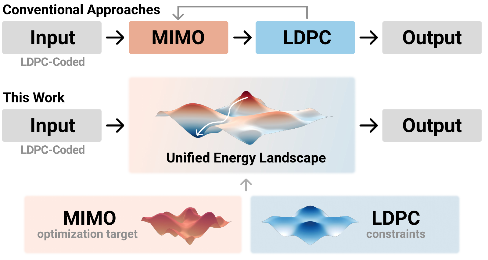
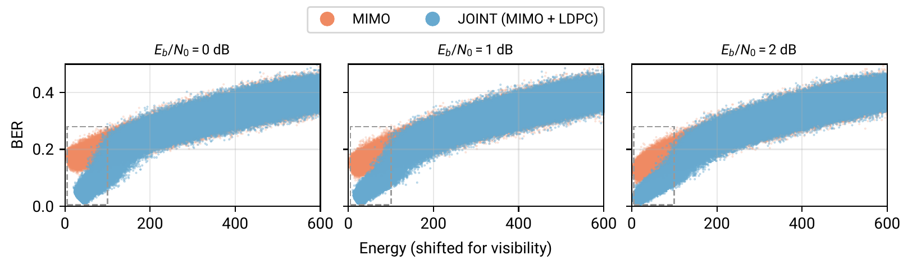
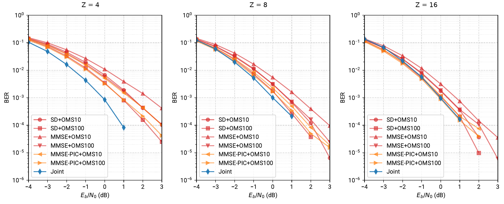

# Joint MIMO Detection + LDPC Decoding on Ising Machines

Receivers usually detect symbols first, then decode the LDPC code. Here an annealer solves both at once, because the joint objective is just **the sum of the two energies**:

```
E(s) = E_mimo(s) + α(t) · E_ldpc(s)
```

- `E_mimo`: the standard Ising form of ML MIMO detection, `‖y − Hx‖²`.
- `E_ldpc`: the number of unsatisfied parity checks.
- `α(t)` ramps from 0 to a target value. The spins first follow the channel, then settle onto valid codewords.

<p align="center"></p>

## Why it works

Most low-energy states of `E_mimo` alone are still full of bit errors. The parity checks raise the energy of every invalid codeword, so under the joint energy, **low energy means low BER**.



The parity term also maps directly onto hardware with no auxiliary spins. Each spin's force from a parity check is just the check's parity XOR its own bit: one shared XOR per check, one extra XOR per spin.

## Results

4×4 QPSK Rayleigh MIMO with 5G NR BG1 LDPC codes. A single anneal beats the separate and iterative (MMSE-PIC) receivers at small lifting factor Z, and matches the strongest of them at Z = 16.


